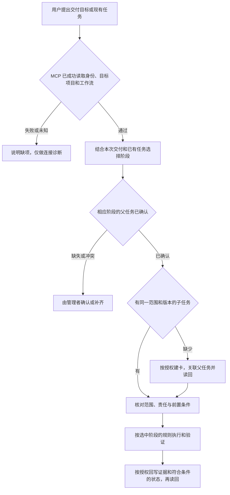
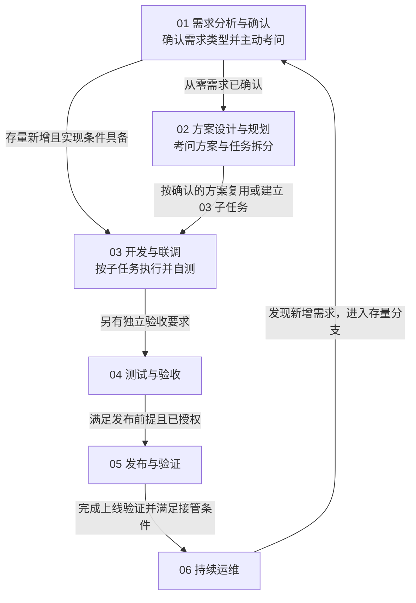
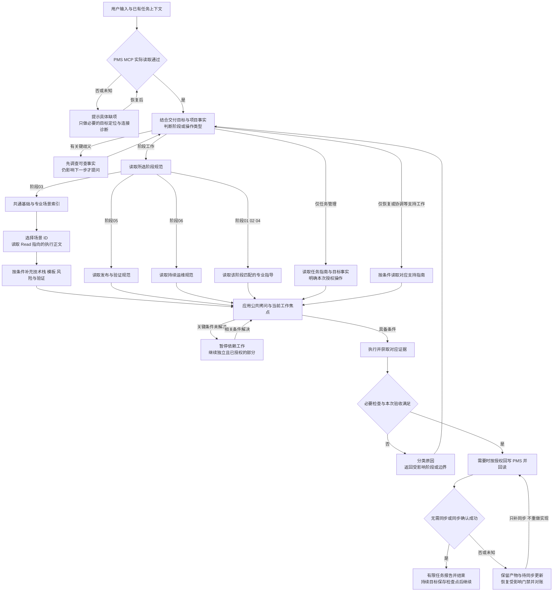

# Engineering Loop 中文路由与执行手册

适用于 **v0.1.30**（2026 年 11 月 20 日核对）。

本手册供团队理解、执行和维护当前 skill。主线是：**用户输入 → PMS MCP 接通 → 判断本次任务阶段和操作类型 → 读取匹配规范 → 解决关键缺口 → 执行与验证 → 按授权回写任务 → 交付**。先确定当前要交付什么，再选择需要的专业、技术栈和风险规则。

现行执行目录有六个阶段。实际项目的有效指令、已确认需求、权限和交付停点继续生效。手册供团队查阅，执行时按 skill 索引读取相关原文。

## 目录

- [逐级填充目录](#逐级填充目录)
- [阶段文档和交接模板](#阶段文档和交接模板)
- [设计讨论与待填细则](#六阶段设计草案)
- [1 术语与范围](#1-术语与范围)
- [2 完整路由流程](#2-完整路由流程)
- [3 MCP 接通条件](#3-mcp-接通条件)
- [4 识别阶段和解决关键问题](#4-识别阶段和解决关键问题)
- [5 六个阶段如何执行](#5-六个阶段如何执行)
- [6 开发与联调的具体分支](#6-开发与联调的具体分支)
- [7 九类共享风险规则](#7-九类共享风险规则)
- [8 技术栈和组件模板的命中](#8-技术栈和组件模板的命中)
- [9 PMS 任务和文档操作](#9-pms-任务和文档操作)
- [10 验证与交付证据](#10-验证与交付证据)
- [11 中断变更失败与恢复](#11-中断变更失败与恢复)
- [12 完整执行示例](#12-完整执行示例)
- [13 规范状态和维护方法](#13-规范状态和维护方法)
- [14 原文入口和验证边界](#14-原文入口和验证边界)

## 逐级填充目录

从 [skill 总入口](../skills/engineering-loop/SKILL.md) 定位本次交付的阶段。下表是维护导航，二级主题链接到现行执行说明或规则原文。第 03 阶段已有独立场景正文，其余阶段在各自的阶段入口按需引用专题指南。

### 六阶段入口与二级主题

| 一级阶段 | 二级主题与现有规范 | 文档或交接模板（按需） | 当前细化程度 |
|---|---|---|---|
| [01 需求分析与确认](../skills/engineering-loop/references/stages/01-requirements.md) | 问题与现状调研、范围与验收例子、实质需求变更，见[需求指南](../skills/engineering-loop/references/requirements.md) | [需求分析与确认](../skills/engineering-loop/templates/requirements.md)，按需记录调研、需求与痛点、访谈、评审确认 | 已有阶段入口及共用需求指南 |
| [02 方案设计与规划](../skills/engineering-loop/references/stages/02-design.md) | [产品规格](../skills/engineering-loop/references/requirements.md)、[架构选型与权衡](#架构选型与权衡)、[项目约定与架构继承](../skills/engineering-loop/references/project.md)、[界面与交互设计](../skills/engineering-loop/references/ui.md)、[启动计划与 PMS 规划](#启动计划与-pms-规划)、[协作与分工](../skills/engineering-loop/references/collaboration.md) | [启动计划](../skills/engineering-loop/templates/kickoff-plan.md) | 架构选型须结合公共拷问，启动计划沿用项目现有样式与规则 |
| [03 开发与联调](../skills/engineering-loop/references/stages/03-development.md) | [开发路由](../skills/engineering-loop/references/development/index.md)、[共通开发基础](../skills/engineering-loop/references/development/core.md)及[四类场景](#开发场景与执行正文) | [模块开发与自测记录](../skills/engineering-loop/templates/development-record.md) | 已有 28 个场景正文及条件规则 |
| [04 测试与验收](../skills/engineering-loop/references/stages/04-testing.md) | [差异评审](../skills/engineering-loop/references/review.md)、[独立测试与集成验证](../skills/engineering-loop/references/verification.md)、[版本与业务验收](../skills/engineering-loop/references/stages/04-testing.md#deliverables) | [测试方案、用例和验收记录](../skills/engineering-loop/templates/acceptance-record.md) | 已有阶段入口和验证指南，版本范围与必验链路逐项对账的细则待补 |
| [05 发布与验证](../skills/engineering-loop/references/stages/05-release.md) | [发布准备、部署切换、上线验证与随版本回退](../skills/engineering-loop/references/release.md) | [发布计划、部署及上线验证记录](../skills/engineering-loop/templates/release-record.md) | 已有阶段入口和发布指南 |
| [06 持续运维](../skills/engineering-loop/references/stages/06-operations.md) | [运行准备、故障调查、日常维护与独立恢复](../skills/engineering-loop/references/operations.md) | [运维和线上缺陷记录](../skills/engineering-loop/templates/operations-record.md) | 已有阶段入口和运维指南，子目录待细化 |

### 阶段文档和交接模板

先定位当前任务及交付物。需要文档或交接时，沿用项目已有格式和存放位置。确需模板时，只读当前交付匹配的模板正文。没有确认的字段留空或标为待定，说明对工作和验收的影响。已知的关键缺口先用公共拷问解决，能继续的独立工作照常推进。 [阶段模板索引](../skills/engineering-loop/templates/index.md) · [公共拷问](../skills/engineering-loop/references/grill.md)

已有简短的任务记录足够时直接复用。交接、任务同步、上线和恢复按项目现有要求和授权执行。共享组件或样式复用遵循对应的组件模板契约。 [组件模板契约](../skills/engineering-loop/references/development/templates.md)

### 开发场景与执行正文

按场景编号进入对应目录，通过 `Read` 链接找执行正文。也可以用[全部 28 个正文的速查表](#开发分支正文速查)直接定位文件。

| 二级目录 | 三级场景 |
|---|---|
| [前端 F1–F8](../skills/engineering-loop/references/development/scenarios/frontend.md) | F1 组件文案与样式、F2 表单与编辑、F3 列表与表格、F4 路由与导航、F5 状态与异步界面、F6 文件与媒体、F7 可访问性与目标设备、F8 前端工程 |
| [后端 B1–B8](../skills/engineering-loop/references/development/scenarios/backend.md) | B1 接口与契约、B2 领域与服务、B3 数据与持久化、B4 事务与并发、B5 身份与资源权限、B6 异步任务与作业、B7 外部服务与 SDK、B8 配置与运行代码 |
| [联调 I1–I8](../skills/engineering-loop/references/development/scenarios/integration.md) | I1 接口对齐、I2 身份与权限链路、I3 跨端数据表达、I4 写入与结果对账、I5 异步业务链路、I6 文件与存储链路、I7 状态与缓存联动、I8 环境与依赖连通 |
| [工程能力 E1–E4](../skills/engineering-loop/references/development/scenarios/engineering.md) | E1 公共库与 SDK、E2 脚本与 CLI、E3 构建与依赖、E4 工具与生成代码 |

### 公共入口与按需规则

| 用途 | 原文入口 |
|---|---|
| 所有阶段的接通校验与关键问题核对 | [MCP 门禁](../skills/engineering-loop/references/connection.md) · [公共拷问](../skills/engineering-loop/references/grill.md) |
| 任务定位与证据回写 | [PMS 任务操作](../skills/engineering-loop/references/pms.md) · [开发交付记录](../skills/engineering-loop/references/development/delivery.md) |
| 随任务事实附加的规则 | [九类开发风险](../skills/engineering-loop/references/development/risks.md) · [技术栈](../skills/engineering-loop/references/development/stacks.md) · [组件模板](../skills/engineering-loop/references/development/templates.md) · [验证边界](../skills/engineering-loop/references/verification-boundaries.md) |
| 项目接入、专项能力、协作和续接 | [项目约定](../skills/engineering-loop/references/project.md) · [专业 skill](../skills/engineering-loop/references/specialists.md) · [协作](../skills/engineering-loop/references/collaboration.md) · [恢复](../skills/engineering-loop/references/resume.md) · [沉淀](../skills/engineering-loop/references/learning.md) |

每轮可从一个阶段主题或场景编号开始。填阶段入口时沿用进入条件、输入、执行与参考、PMS、交付物和退出条件六项。填具体场景时补触发与排除条件、执行正文、验收例子和项目绑定项。选一条应命中的任务及一条相近反例，按[命中率评测口径](../evals/README.md#measure-routing-hits)冻结预期并安排试跑。更多维护约定见 [第 13 节](#13-规范状态和维护方法)。

## 六阶段设计草案

本节用于继续讨论 PMS 阶段父任务、01 和 02 的考问及各阶段待填细则。可按[逐级讨论目录](#逐级讨论目录)选题。实际执行以[现行目录](#逐级填充目录)和对应规范为准。

### 逐级讨论目录

| 一级阶段 | 下一级讨论入口 | 待填内容 |
|---|---|---|
| [01 需求分析与确认](#01-需求分析与确认) | 从零建立需求、现有系统新增需求 | 两类产物、验收及确认方式，存量重大变更的专项设计归属 |
| [02 方案设计与规划](#02-方案设计与规划) | 从零项目的方案考问、团队采用的开发任务拆分方式 | 项目特定方案规则、产物格式、子任务粒度和字段 |
| [03 开发与联调](#03-开发与联调) | 前端 F1–F8、后端 B1–B8、联调 I1–I8、工程能力 E1–E4 | 逐项补执行与验证细则，确定进度汇总口径 |
| [04 测试与验收](#04-测试与验收) | 差异评审、独立测试与集成验证、版本与业务验收 | 版本覆盖核对、业务签认及其他阶段细则 |
| [05 发布与验证](#05-发布与验证) | 发布准备、切换与上线验证 | 观察窗口、发布完成与运维交接条件 |
| [06 持续运维](#06-持续运维) | 候选主题包括运行观察、故障响应与恢复、日常维护 | 子目录、职责及实际检查要求 |

### PMS 项目与任务

如果项目选择六阶段父任务结构，管理者可在 PMS 建立具名项目及六张阶段父任务。关系示例为「PMS 项目 → 阶段父任务 → 具体交付子任务」。是否另设项目总任务、采用何种子任务粒度，由项目确认。阶段父任务表示工作归属，子任务状态对应项目实际看板流程，跨任务前置关系连接真正依赖的交付物。

下图是纳入 PMS 跟踪且采用阶段父任务的交付示例。



连接恢复或父任务补齐后回到相应校验。回写时记录实际产物、版本、验证证据和阻塞，确需推进时按项目工作流核对条件。发现创建或更新结果不明时，先核对实际记录。阶段父任务如何汇总、由谁推进仍待细化。 [现行 PMS 指南](../skills/engineering-loop/references/pms.md)

### 阶段衔接



按当前交付直接进入匹配阶段。已有明确的开发任务可直接进 03，独立验收可针对已知构建进入 04，已有有效验收证据的发布准备可直接进 05，实际运行事件可直接进 06。每次衔接都看当前工作范围、已实现的前置条件和已有授权。

### 01 需求分析与确认

先看目标项目、已有产品和任务事实。进入 01 时主动与用户确认「这次是从零建立需求，还是在已完成的系统上新增需求？」用户已明确的答案直接沿用，发现事实冲突时说明原因再追问。确认后进入对应子目录，主动考问该分支的关键缺口。

| 子目录 | 考问重点 | 产物 |
|---|---|---|
| 从零建立需求 | 谁遇到什么问题，现用方式哪里不足，第一版解决什么，成功和失败如何识别 | 待讨论 |
| 现有系统新增需求 | 复用当前行为和已定约定，核对新增目标、受影响用户或链路、需要延续的行为及验收边界 | 待讨论 |

从零需求确认后按授权进入 02。存量需求明确范围、验收与实现条件后可进入 03，已明确的开发子任务直接进入 03。待讨论的反例是存量系统新增功能却必须调整架构、权限或数据契约。建议先在 01 确认影响和专项设计前置，专项设计子任务的阶段归属待定。

### 02 方案设计与规划

以从零建设项目中已确认的需求为输入。主动核对方案是否漏掉重要需求、是否有更简单的做法，以及关键取舍、跨端契约、故障场景和验收条件是否经得住反例。把需求逐项对应到方案及可独立验收的开发成果，找出遗漏、重复和依赖不清的任务。

项目采用阶段父任务时，可将批准的开发子任务放在已确认的 03 父任务下，并按需关联设计产物和实际的阻塞前置。项目具体拆分规则、样式及任务字段仍由项目确认。

现行阶段 02 已提供架构选择规范和启动计划模板。 [架构选型与权衡](#架构选型与权衡) · [启动计划与 PMS 规划](#启动计划与-pms-规划)

### 01 和 02 的主动考问

两阶段应用[公共考问方法](../skills/engineering-loop/references/grill.md)，并将考问结果带入下一步。01 挑战用户提出的需求是否覆盖真实问题，02 挑战拟采用的方案和任务拆法能否满足该需求。

1. 先查现状、已确认事项和可复核证据，找出最可能改变结论的假设。
2. 主动提出能检验假设的反例。发现可行备选时，给出建议，并说明取舍对范围、验收、工期或风险的影响。按依赖顺序向用户追问实质未决项。
3. 记录结论、理由和暂未解决的影响。逐项核对用户提出的要求和讨论发现的影响，标明已覆盖、明确排除或待决，再推进具备条件的工作。

### 03 开发与联调

项目采用 PMS 子任务跟踪时，从设计阶段已规划的子任务开工。存量需求等工作可按项目规则使用新建的 03 子任务。先核对该卡的范围、责任、前置和验收要求，再依据本次变更选择[前端、后端、联调或工程能力的场景正文](#开发场景与执行正文)，按实际技术栈和变化风险补相应规则。一个可验收的成果可以覆盖多类规范。只有成果可独立验收时，才考虑为它独立建卡。开发自测随子任务在本阶段完成，各类执行细则按任务逐级补充。

量化以同一版本已确认的子任务范围为基础，按实际状态统计未开始、执行中、待验收和已验收，另标阻塞。开发完成与业务签认各自记录，正式汇总口径后续讨论。

### 04 测试与验收

围绕指定产物和版本执行独立评审、测试或业务验收。验证发现问题时，先定位属于实现、需求、环境还是检查本身，再回到受影响的工作。版本覆盖清单、业务签认和通过条件待讨论。 [现行测试指南](../skills/engineering-loop/references/stages/04-testing.md)

### 05 发布与验证

围绕一次版本发布，覆盖准备、授权切换和上线验证。以上线结果支持本次版本交付，观察窗口和运维接管条件待讨论。 [现行发布指南](../skills/engineering-loop/references/release.md)

### 06 持续运维

处理已上线系统的持续工作，包括运行观察、实际事件、故障恢复和日常维护。发现新增业务需求时回到 01 的存量分支。06 的子目录、责任与实际检查细则待讨论。 [现行运维指南](../skills/engineering-loop/references/operations.md)

## 1 术语与范围

### 不同层级分别回答什么

| 层级 | 回答的问题 | 当前例子 |
|---|---|---|
| 项目阶段 | 本次任务交付哪一类结果 | 需求、方案、开发、测试、发布、持续运维 |
| 专业方向 | 哪一类实现或链路受影响 | 前端、后端、联调、工程能力 |
| 场景 | 正在改变什么具体行为 | 表单编辑、接口契约、未知写入结果 |
| 技术栈 | 当前模块实际采用什么实现 | 已安装的 React、Vue、后端框架或 CLI 运行时 |
| 风险规则 | 哪个变化边界需要额外约束和证据 | 权限、幂等、并发更新、数据精度 |
| 组件模板 | 有无适合当前用途且兼容的现成设计 | 实际目录中的组件 ID、参数、状态和示例 |
| PMS 状态 | 某张任务卡执行到什么状态 | 项目实际返回的待开始、执行中、待评审等状态 |

**任务所处阶段、整个项目的总体进度和卡片状态是三个不同事实。** 同一项目的模块 A 可以在验收，模块 B 仍在开发；B 的局部修复按照 B 的交付目标路由，不被 A 的状态替代。

专业、技术栈和风险也不是互斥分类。一个前端保存问题可能同时涉及服务端版本校验；一个联调任务只读实际涉及的双方和边界，不要求读完所有前后端规范。

### 何时启动本流程

团队交付、任务管理、状态不明的项目恢复或明确调用 Engineering Loop 时，进入本流程。进入阶段后的纯分析任务同样需要 MCP 门禁。工作流之外的独立解释、概念问答保持轻量；不能用“只是分析”绕过已经激活的阶段门禁。

分析不自动授权实现，实现不自动授权发布、破坏性数据操作或对外发送消息。已有明确授权继续有效，不因为阶段或专业变化重复请求相同批准。明确的停止、替换任务、暂停和“仅草稿”要求优先。

原文：[SKILL.md](../skills/engineering-loop/SKILL.md)。

## 2 完整路由流程



图表示当前交付的逻辑依赖。按目标进入六个阶段中的对应入口，并复用仍然有效的连接、决定、正文读取和验证证据。

执行时可以使用以下顺序核对：

1. 确定用户要的结果和权限边界，例如只分析、只设计、修改代码或实际部署。
2. 完成或复用有效 MCP 接通证据；失败时停止下游。
3. 必要时只读现有任务和项目记录，确定当前切片的阶段。
4. 读取该阶段，应用公共拷问，补齐会影响行为、验收或权限的缺口。
5. 开发任务按专业和场景选择执行正文，再按条件附加技术栈、组件模板、风险及检查。需要阶段文档或交接时，优先沿用项目记录，按需选择本阶段的模板。
6. 执行当前已成立的工作，遵守项目要求的评审、提交或发布停点。
7. 区分通过、失败、未运行，记录实际版本、环境和范围。
8. 涉及任务跟踪时，按已有授权同步产物和实际状态并回读；最后交付结果及剩余限制。

## 3 MCP 接通条件

### 什么才算接通

进入任何已激活阶段或专业 skill 前，至少核对三类实际读取：

| 校验项 | 需要取得的事实 | Kaneo 对应工具 |
|---|---|---|
| 能力与身份 | 所需工具存在，身份读取成功，知道当前连接使用哪个账号 | `whoami` |
| 目标项目 | 读取明确指定或维护配置中的项目，返回身份与目标一致 | `get_project` |
| 工作流 | 读取这个项目的实际状态及可用值 | `list_project_columns` |
| 相关必需字段 | 下一操作涉及必填或自定义字段时，读取其定义和选项 | `list_project_custom_fields` |

以上是必须成立的事实，不要求把无依赖的读取机械串行执行。看板链接只能标识项目，不能当作 MCP 服务地址；工具已经注册、配置文件写着已启用、元数据列了依赖，也不等于读取成功。

连接证据应能指向实际成功结果，包含连接身份、目标、所需能力、状态映射和限制。以实际 MCP 身份读取确认操作者，通过项目成员和任务查询核对负责人或受指派成员。用户或项目要求个人连接时，按每人的实际连接核验目标、工作流和所需能力，并用稳定账号标识或权威账号映射匹配预期成员。浏览器与 MCP 身份不一致时，核对负责本次操作的 MCP 连接。

明确授权新建项目时，先核对操作者、目标工作区和建项目能力，并查找匹配项目。创建后读取实际项目和工作流，通过门禁后再开展阶段工作或写入任务。

### 不满足条件时怎么办

工具缺失、鉴权失败、目标错误或无访问权、状态无法读取，以及相关必需能力不可用，都不能继续下游阶段、专业执行或代码／PMS 写入。

此时只做必要的目标发现、连接诊断和已有权限内的修复，报告具体缺项。不得静默离线开发、换到另一个可访问项目、暴露凭据，或绕过必须的 MCP 改用直接 API。目标不明确时，只询问缺少的目标决定。

例如，身份可读但项目访问被拒绝，仍然未通过门禁；项目和状态都可读，也只证明读取能力，不证明允许创建卡片、分配负责人或发布版本。

### 哪些证据可以复用

同一会话、身份、目标和相关连接条件保持有效时，可以复用成功读取，不因一次编辑或阶段切换重复探测。账号、目标、权限改变，或出现鉴权、传输、连接错误时，重新核对受影响部分。

恢复连接时保留已完成产物、实际运行句柄及待同步更新。不能为修复同步而重做已经验证的实现。

原文：[connection.md](../skills/engineering-loop/references/connection.md)。这些是 agent 必须遵守的流程条件；真正的工具权限、原子领取和服务端状态门禁仍由宿主或 PMS 能力决定。

## 4 识别阶段和解决关键问题

### 阶段依据

按本次交付目标、现有任务、受影响路径、项目配置、代表实现和实际调用边界判断。关键词只用于发现候选：

- “后台管理页按钮”通常指浏览器界面，不能仅凭“后台”选择后端开发。
- “做一个页面”可能是设计原型，也可能是实现已有设计；先查已有约定，只有缺失决定会改变工作时才问。
- “上线前检查”不等于授权部署；先确定交付的是检查结果、发布方案还是实际发布。
- 已部署系统的请求按目的选阶段。验证某次发布或执行该版本的回退进入 05，独立运行故障、运维修复或恢复进入 06。
- 一个可见的保存问题可能发生在客户端、接口、持久化或跨端契约，不能先假定只改提示文案。

可从代码或任务记录查到的事实，应先调查。不要让用户选择内部 skill 名称或代替 agent 找文件。

### 公共拷问如何使用

每个阶段和所选专业都沿用同一套拷问方法：确认当前结果和边界，核对关键假设，再找一个相关失败例子或合法例外，判断现有证据是否足够支持下一步。

这是内置的 grill.md 方法，不要求另装同名 grill-me skill 或工具，也不设置固定题数或访谈轮数。

只询问尚未解决、且会改变行为、验收、授权或高成本返工的决定。问题应说明推荐方案、可选路径、代价和可逆性；有前置依赖的决定按依赖顺序问。尊重用户希望一次只讨论一题的偏好。

已确定的方向和已回答的问题不重复打开；信息充分时可以零提问。未答复不等于接受，拷问也不替代测试、独立评审或实际验收。缺少关键决定只阻塞依赖部分，不妨碍独立且已授权的工作。

### 哪些情况重新路由

阶段发生变化、范围或风险实质改变、出现冲突证据，或需要从不确定状态恢复时，重新定位受影响部分。不要每条消息、每次编辑都重路由、重读所有文档或重开访谈。

原文：[grill.md](../skills/engineering-loop/references/grill.md)、[开发路由](../skills/engineering-loop/references/development/index.md)。

## 5 六个阶段如何执行

六个阶段使用相同的规范结构，包含进入条件、输入、执行与参考、PMS 使用、交付物和退出条件。阶段之间按当前任务的依赖连接。

### 需求分析与确认

**进入条件：** 需要调查问题、核对现状、确定行为边界，或处理会实质改变验收的需求变化。

先整理用户目标、当前行为、已有任务与需求记录、已确认决定和未知项。区分观察事实、期望、假设和待定政策；未验证的产品假设可以成为调查对象，不应被直接写成已成立的需求。

执行时核对用户正在完成什么任务、现有替代方法、成功信号及当前最小切片。用正常、拒绝和不确定结果的代表例子确认边界；只有影响本次工作的问题才继续澄清。必要时做已有授权内的小调查或实验。明确需求已经足够的局部修改不重开完整调研。

交付已确认结果、范围和排除项、验收例子、依据及未决决定，复用现有文档或任务记录。需要结构化记录时，选择模板中适用于从零建立需求或已有系统新增需求的部分，保留已确认范围和验收口径。当前切片的下一步条件成立即可退出。只要求调查时，交付调查结果后结束。需要设计或实现时，再按已有授权进入下一相关阶段。 [需求文档模板](../skills/engineering-loop/templates/requirements.md)

入口：[01-requirements.md](../skills/engineering-loop/references/stages/01-requirements.md)。按需正文：[requirements.md](../skills/engineering-loop/references/requirements.md)；缺少或冲突的项目约定进入 [project.md](../skills/engineering-loop/references/project.md)。

### 方案设计与规划

**进入条件：** 当前交付是产品规格、架构决定、界面／交互设计或交付计划。

复用已确认行为、现有架构、设计系统、项目约定和交付约束。只核对本设计切片的前提；已有共识足够时，不强制补齐整套 PRD 或重新做设计讨论。

按本次设计问题选读相应指导。行为规格查需求指南，架构选型和启动计划查本阶段的对应规范，职责和架构继承查项目指南，界面决定查 UI 指南，共享组件或样式查模板契约，委派与集成计划查协作指南。先验证会造成返工的关键决定，再复制类似设计。

UI 默认设计和验证桌面端；用户明确要求的设备及已有有效项目要求按相应范围处理，不能擅自删除已有移动端行为。静态渲染用于视觉判断；导航、编辑、焦点或恢复等问题需要对应交互证据。纯设计建议本身不强制启动浏览器验收，无法渲染时也不能宣称界面已经完成实测。

交付实际规格、设计、架构决定或计划，记录版本、范围、前提、决定和未决项。关键业务冲突返回阶段 01。设计工作完成不自动开始代码实现，设计原型也不证明后端集成或生产可用。

入口：[02-design.md](../skills/engineering-loop/references/stages/02-design.md)。相关正文：[ui.md](../skills/engineering-loop/references/ui.md)、[项目指南](../skills/engineering-loop/references/project.md)。

#### 架构选型与权衡

选型会实质影响交付、性能、总成本或维护时，**架构选型须结合现有「拷问我」方法**。先查项目已有材料，用足以影响判断的反例或失败场景检验推荐，逐项核对已确认需求和硬约束的证据或验收条件。会改变方案、验收、权限或导致显著返工的问题，用可复核的证据、小验证或有权人的决定收口。实质问题仍待解决时，给出带条件的推荐和受影响的停点。 [架构选型规范](../skills/engineering-loop/references/architecture.md) · [公共拷问](../skills/engineering-loop/references/grill.md)

1. **把用户目标写成可验证场景。** 从实际使用者、关键操作和代表数据推导典型及峰值负载，写清用户路径的响应目标。有后台任务时，分别记录从操作发起到可见反馈、从任务提交到结果可用的等待。标明指标来自实测、已确认目标、估算还是未知。
2. **在同一负载和周期下比较。** 先找团队能交付、维护且达到确认目标的最小完整方案。评估会改变决定的可行选项时，纳入交付工期、运行与许可费用、维护和迁移投入。按有效项目约束、团队能力和实际场景选择语言、部署形态、存储和中间件。增加组件前，明确原方案的不足及如何验证收益。
3. **以验证与复查条件收口。** 证据支持最小方案达标，且剩余不确定性不会改变选择时，交付推荐、关键取舍和验收方法。会改变选型的证据缺口用能区分选项的小验证处理。按需要记录触发复查的实际需求或指标。

质量场景、渐进设计和成本建模的参考资料见以下原文。 [架构设计 skill](https://github.com/magnus919/agent-skills/blob/main/software-architecture/SKILL.md) · [容量与成本 skill](https://github.com/magnus919/agent-skills/blob/main/capacity-and-cost-engineering/SKILL.md) · [Google SRE 逐步设计](https://sre.google/workbook/non-abstract-design/) · [arc42 质量场景](https://docs.arc42.org/tips/1-12/) · [AWS 成本建模](https://docs.aws.amazon.com/wellarchitected/latest/framework/cost06-bp01.html)

#### 启动计划与 PMS 规划

需要把已确认的范围转为开工计划或 PMS 任务规划时，沿用项目的文档样式和工作规则。同一份计划记录草稿、开工拷问与决定、已批准的任务及同步结果。项目已有样例时沿用其版本头、编号分节和表格。具体字段、格式和任务粒度未确认时，标明待定项及其影响。 [启动规划指南](../skills/engineering-loop/references/delivery-planning.md) · [启动计划模板](../skills/engineering-loop/templates/kickoff-plan.md)

| 四项成果 | 计划引用或记录的内容 |
|---|---|
| 产品设计方案 | 范围、关键流程与验收依据 |
| 技术设计方案 | 技术边界、共享 API 与数据设计、相关依赖 |
| 开发任务与排期表 | 工作项、依赖、负责人和估算依据。分别估算人工有效投入和到可验收的日历历时，考虑并行、依赖和等待 |
| 模块分工与开工检查 | 归属、交接、所需环境与权限、阻塞项和开工证据 |

阶段 03 的开发实现与自测各留证据。同一项工作的交付归属一致时，可按项目规则记录在同一张卡。评审责任或交接需要单独跟踪时，关联对应评审卡。实际进入阶段 04 时，把验收任务或记录关联到对应交付，写明验收对象、证据及结果。

按现有权限同步已批准范围。同步前通过真实 MCP 读取确认操作者、目标项目和工作流，核对任务归属及成员。按计划行标识和范围查重、复用或创建，再回读并把任务链接记回计划。项目采用六阶段父任务时，按实际确认的父项归属。 [MCP 接通条件](#3-mcp-接通条件) · [PMS 操作](#9-pms-任务和文档操作)

### 开发与联调

**进入条件：** 已授权的实现切片、缺陷诊断或跨模块／跨系统链路工作。

复用有效需求、适用设计／契约、现有代码、调用方、项目命令和任务依赖。先读共通开发基础，再选择相关专业及场景 ID，读取该场景 **Read 指向的执行正文**，按实际变化添加风险、技术栈或模板规则。索引的摘要和检查字段不替代执行正文；已经读过且仍有效的正文可以复用。

实现应覆盖一段可解释、可评审、可验证的完整行为。Bug 先复现并形成可证伪假设，再改相关原因，保留有区分力的回归。沿用已有架构、库和命令，不为了目录统一新增空层或平行框架；必要的权限、验证和恢复不能以缩小差异为由省略。

开发自测随实现进行，不等待整个项目进入测试阶段。交付代码／配置、相关契约或文档、真实检查结果、版本及剩余限制。业务冲突返回阶段 01，设计冲突返回阶段 02；只有需要更广验证或独立验收时，进入阶段 04。

入口：[03-development.md](../skills/engineering-loop/references/stages/03-development.md)、[开发路由](../skills/engineering-loop/references/development/index.md)、[共通基础](../skills/engineering-loop/references/development/core.md)。旧 [implementation.md](../skills/engineering-loop/references/implementation.md) 仍是兼容入口。

### 测试与验收

**进入条件：** 当前交付是测试结果、独立差异评审、集成验证或业务验收。只要求评审时保持只读，除非另有修改授权。

明确验收例子、受测产物／提交、配置和环境、变化边界以及有效的历史证据。按要证明的结论选择文档／静态、模拟、真实运行、集成和用户验收检查。评审具体差异时读评审指南；涉及可见和交互行为时读 UI 相关指导；只读取匹配的验证边界章节。

期望结果来自已接受例子、独立计算或权威契约，不能仅从实现反推。集成工作验证合并后的实际行为；分别通过检查或成功合并不证明组合正确。失败时先分类，不删除断言或放宽容差来适配错误实现。

交付通过、失败、未运行的分项记录，包含命令／方法、版本、环境、覆盖范围、问题和限制。必需证据及有权验收的结果支持结论后退出。实现问题返回阶段 03，需求冲突返回阶段 01，环境或夹具问题在相应边界处理；测试通过不自动授权发布。

入口：[04-testing.md](../skills/engineering-loop/references/stages/04-testing.md)。正文：[verification.md](../skills/engineering-loop/references/verification.md)、[边界检查](../skills/engineering-loop/references/verification-boundaries.md)、[review.md](../skills/engineering-loop/references/review.md)。

### 发布与验证

进入此阶段的工作包括发布准备、已授权的部署或切换、对指定发布的上线验证，以及随该版本执行的回退或恢复。

核对目标环境、操作权限、产物和配置版本、适用验收依据及现有运行手册。按发布范围验证迁移、切换、现有使用方兼容和恢复前提。发布依赖运行准备、恢复证据或运维交接时，读取相应运维指导。

交付发布方案或发布验证记录，标识版本、环境、操作、恢复前提、实测结果和未验证范围。上线验证覆盖当前发布所需的关键业务路径及相关现有使用方。执行部署、回退或外部变更时，按已有授权与项目停点推进。

完成本次准备或取得所需上线证据后交付。版本相关故障按此次发布的授权恢复路径处理，独立运行事件和交接后的持续工作进入 06。 [阶段 05](../skills/engineering-loop/references/stages/05-release.md)

### 持续运维

已有服务的日常维护、运行准备、实际故障、独立配置修复及恢复验证可以直接进入此阶段。

先核对真实运行实例、环境、版本、影响范围与运行手册。围绕可证伪的假设选择最小干预的检查，纯调查按只读授权执行。获准修复或恢复后，同时核对服务恢复和受影响的实际业务路径。需要恢复证明时，在合适的隔离目的地取得证据。

沿用现有运维、就绪或故障记录，保存范围、影响、检查结论、执行动作和剩余风险。涉及 PMS 跟踪时，按授权关联实际运行事件或维护交付。需要修改代码时按范围转 03，获准发布版本时转 05，发现新的业务需求时回 01。 [阶段 06](../skills/engineering-loop/references/stages/06-operations.md) · [运维指导](../skills/engineering-loop/references/operations.md)

线上缺陷可在运维记录中跟踪，独立回归或版本验收引用对应的 04 结果。已有参考中的《缺陷跟踪与测试验收记录》涉及两个阶段，具体归档归属仍待项目确认。 [运维记录模板](../skills/engineering-loop/templates/operations-record.md) · [测试验收记录模板](../skills/engineering-loop/templates/acceptance-record.md)

## 6 开发与联调的具体分支

当前共有前端 8 项、后端 8 项、联调 8 项、工程能力 4 项，共 28 个场景。方向可按变化边界组合。先定位实际模块和场景，再读对应正文；不把 28 份正文作为每次都要加载的清单。

每个分支都沿用项目既有技术栈、组件库、目录、命令和已确认业务政策。下面说明本次执行应做的事；项目特定的默认值、库版本、权限矩阵和恢复政策仍由项目的有效来源确定。

### 前端开发 F1 至 F8

前端分支由实际浏览器组件、页面行为、客户端状态或前端构建变化触发。“后台管理页”中的“后台”不等于后端开发。确认框架、组件库和版本时查当前模块配置，不按整个仓库统一猜测；只做交互设计的请求仍进入阶段 02。

#### F1 组件 文案与样式

**路由 ID：** `dev.frontend.components`。**执行正文：** [组件执行细则](../skills/engineering-loop/references/development/frontend/components.md)。

**进入与输入：** 修改组件文案、token、主题、变体、按钮状态、图标或间距；先确认组件调用方、已接受的内容与动作、目标设备和现有组件用法。

1. 查找项目已有组件及相近已确认用法，复用公开参数、token 和包约定；确有模板复用需求时才进入模板索引。
2. 区分纯文案、视觉和行为变化。已确认的标签替换只改指定文字，保留处理函数、按钮类型和无关内容。
3. 真实状态变化只覆盖相关加载、禁用、焦点或失败状态；检查包装组件实际生成的交互元素与名称。危险样式不增加删除等业务授权。
4. 共享组件扩展先验证一个代表用法，再核对受影响调用方；不另建平行组件系统。

**验收与交付：** 纯文案可做范围内一致性检查；视觉或交互结论须有 R9 对应证据。权限变化附加 R2，不能把隐藏或禁用当作服务端鉴权。记录组件、调用方、参数／状态和实际检查结果；组件库、token、图标和模板 ID 沿用项目来源。

#### F2 表单与编辑

**路由 ID：** `dev.frontend.forms`。**执行正文：** [表单执行细则](../skills/engineering-loop/references/development/frontend/forms.md)。

**进入与输入：** 字段校验、草稿、提交、取消或失败后保留输入发生变化；确认字段含义、已保存值、校验归属、保存结果和返回路径。

1. 追踪初始数据、可编辑状态、请求载荷和保存响应，保留缺失、空串、零与 null 的契约差别；显示默认值不能覆盖已保存内容。
2. 客户端反馈与既有校验契约一致；前端校验不能替代服务端校验或权限检查。
3. 按实际流程区分提交中、已接受与已完成，失败时保留相关可编辑输入。
4. 重复提交或结果未知附加 R4，旧页面保存附加 R5；不擅加自动保存、退出确认或取消政策。

**验收与交付：** 用已接受的正常例子及相关拒绝／失败例子，比较输入、载荷、保存值与可见结果；走完成功／返回路径。只在冲突或重复提交确属范围时检查对应顺序。交付字段含义、变更边界和证据，表单库、草稿归属及错误展示仍由项目确定。

#### F3 列表与表格

**路由 ID：** `dev.frontend.collections`。**执行正文：** [列表表格执行细则](../skills/engineering-loop/references/development/frontend/collections.md)。

**进入与输入：** 修改筛选、分页、排序、选择、批量操作或列表状态；确认查询归属、行标识、排序／分页语义、权限和操作结果。

1. 从控件或 URL 追踪到请求、显示行和总数；筛选后是否重置分页按项目契约处理。
2. 用稳定资源标识执行行操作；仅在功能支持时区分“本页选择”和“全部匹配记录”，不能默默扩大批量范围。
3. 对相关无结果、加载、查询失败和动作不可用状态使用代表内容，不顺手新增列或功能。
4. 批量结果按整批／逐项契约对账；修改或返回后通过现有机制呈现更新结果，不把缓存失效回调当作用户已看到新数据。

**验收与交付：** 使用独立已知数据检查查询、排序／分页和行操作；记录选择范围、行身份、返回结果与限制。跨端数值、权限、批量异步和布局结论分别按需附加 R1、R2、R4、R9；不因一个页面通过就声称全查询组合覆盖。

#### F4 路由与导航

**路由 ID：** `dev.frontend.navigation`。**执行正文：** [导航执行细则](../skills/engineering-loop/references/development/frontend/navigation.md)。

**进入与输入：** 路由参数、进入／返回路径、上下文保留或页面访问变化；确认 URL、参数、导航状态归属、主动作和支持的退出位置。

1. 跟踪直接进入和应用内导航，沿用 URL、页面草稿及共享状态的现有归属，不增加第二个状态来源。
2. 参数解析、编码须保留资源身份；无效或缺失参数按既有结果处理，不能猜测一个资源。
3. 完成代表任务并沿支持的返回路径检查筛选、上下文和更新后的数据。
4. 访问变化在实际资源边界附加 R2；沿用既有退出、重定向和回退行为，不擅加确认弹窗或更改历史策略。

**验收与交付：** 检查相关深链接、普通导航及返回路径；必要时加入无效／未授权参数与合法对照。身份转换附加 R1，导航焦点或交互结论附加 R9。记录受影响路由、参数、状态归属及实际路径证据。

#### F5 状态与异步界面

**路由 ID：** `dev.frontend.async-state`。**执行正文：** [异步界面执行细则](../skills/engineering-loop/references/development/frontend/async-state.md)。

**进入与输入：** 加载／错误反馈、请求顺序、重复动作、缓存刷新或异步完成变化；确认操作身份、状态所有者、结果协议及可见完成信号。

1. 从用户动作追踪请求、响应与界面状态，按契约区分已接受、已完成和结果未知。
2. 将响应关联到原操作／上下文，防止过期响应覆盖当前视图，同时保留流程允许的并行合法结果。
3. 复用现有状态和缓存机制；客户端中止或组件卸载不等于服务端工作已取消。
4. 重试／未知结果用 R4，持久化竞争用 R5；使用真实状态协议，不以固定等待、猜测轮询或提前成功提示掩盖未知状态。

**验收与交付：** 按相关延迟、乱序或失败序列及正常对照检查可见结果，并走支持的刷新／返回路径。反馈、焦点和可访问结论用 R9；记录操作所有权、状态顺序、完成／恢复证据及未决协议。

#### F6 文件与媒体

**路由 ID：** `dev.frontend.files`。**执行正文：** [文件媒体执行细则](../skills/engineering-loop/references/development/frontend/files.md)。

**进入与输入：** 上传、预览、进度、取消、续传或下载变化；确认内容身份、已接受的文件约束、存储／服务路径、资源归属和完成结果。

1. 追踪所选内容、预览、请求／会话与最终资源，区分原件、预览和生成产物。
2. 使用项目实际类型／大小约束；客户端元数据和进度不能证明存储已接受的字节。
3. 续传、直传和配额用 R7；会话复用前确认原内容身份，不能仅比较名称、大小和时间。签名／归属访问用 R2。
4. 失败保留相关输入及恢复线索，按既有协议区分本地中止、服务端取消与已存储；仅释放自己已不再使用的临时预览资源，不使仍展示／可下载的结果失效。

**验收与交付：** 检查合法文件及相关拒绝、中断或恢复路径，分别说明预览、存储、下载和生成质量的证据。交付安全资源引用、约束来源及结果，不把凭据、签名 URL 或私有文件内容写入通用示例。

#### F7 可访问性与目标设备

**路由 ID：** `dev.frontend.accessibility-targets`。**执行正文：** [可访问性与设备执行细则](../skills/engineering-loop/references/development/frontend/accessibility-targets.md)。

**进入与输入：** 键盘／焦点、控件名称、状态反馈、缩放、长内容或溢出变化。默认桌面端；明确要求及项目已有移动端行为继续有效。

1. 在接受的设备、任务和真实内容上检查实际渲染控件，不能只看属性或组件库包装层。
2. 用键盘走受影响交互，检查可操作性、可见焦点、顺序和打开／关闭后的焦点位置。
3. 按 R9 检查相关角色、名称、关系、对比度及动态反馈；自动扫描区分明确违规、不完整检查与人工发现。
4. 有缩放缺陷时检查真实浏览器缩放；窄窗口不等于新增手机范围，小视口也不等于缩放证据。

**验收与交付：** 记录路线、目标、内容／状态及实际观察。声明辅助技术行为时保留实际证据，不能由 DOM 属性推断播报成功；缺少必要证据记为未验证。浏览器支持范围与可访问阈值由项目指定。

#### F8 前端工程

**路由 ID：** `dev.frontend.engineering`。**执行正文：** [前端工程执行细则](../skills/engineering-loop/references/development/frontend/engineering.md)。

**进入与输入：** 前端构建、资源路径、依赖、运行兼容或性能缺陷；确认模块、构建配置／锁文件、入口、运行目标和代表性复现。

1. 用项目命令复现并定位失败阶段，先区分构建、运行、依赖或代码原因，再改动工具链。
2. 沿用配置、资产和版本归属，不自动升级；新增依赖须有当前必要性及维护影响。
3. 从真实构建入口追踪资源 URL／动态模块路径，开发服务或源码 import 不能证明最终产物可用。
4. 共享构建／依赖变化进入对应 E 分支；SDK 传输变化附加 R8。可比较时使用相同任务、产物和环境测前后性能，不靠减少工作量掩盖缺陷；不可比处保留限制。

**验收与交付：** 运行项目门禁和受影响资源／运行路径，区分预览、构建产物与部署环境；可见行为用 R9。记录配置／依赖／产物身份、复现及测量结果。修好本地构建不等于已部署，部署仍按阶段 05 授权。

### 后端开发 B1 至 B8

后端分支要求存在真实服务、接口、持久化或服务端作业边界。沿用当前模块的语言、框架、数据库和项目契约；本 skill 不统一指定分层目录、响应外壳或鉴权包。

#### B1 接口与契约

**路由 ID：** `dev.backend.api`。**执行正文：** [接口执行细则](../skills/engineering-loop/references/development/backend/api.md)。

**进入与输入：** 路由、请求／响应、校验或错误含义变化；确认调用方、正常／拒绝例子、API 清单、权限边界和契约命令。

1. 追踪传输校验、鉴权、业务效果与响应映射，按现有职责边界修改。
2. 按接受的输入形状做运行时校验；对象契约在字段访问／受保护写入前拒绝非法 JSON、null、数组和标量，同时保留合法数组／标量接口。
3. 保留缺失、null、空与零的约定差别，按需附加 R1／R2。
4. 同步权威契约及受影响调用方；Controller 变更运行实际 API 库存／生成检查，沿用错误与状态语义。

**验收与交付：** 测正常请求和相关类型／边界拒绝，检查响应，并确认不存在无意的受保护业务写入；契约通过不等于真实消费方已联通。记录操作、例子、契约版本、调用方和实际检查，不新建统一响应格式。

#### B2 领域与服务

**路由 ID：** `dev.backend.domain`。**执行正文：** [领域服务执行细则](../skills/engineering-loop/references/development/backend/domain.md)。

**进入与输入：** 业务不变量、职责、依赖方向或写入归属变化；准备已接受例子、领域术语、实际调用方、权威状态和代表实现。

1. 将不变量写成可观察的通过／拒绝例子，明确决策归属和证明数据；未决定业务政策保持待定。
2. 追踪现有校验和每个副作用所在位置，不能用类名或目录名代替职责核对。
3. 在维护中的责任边界完成改动，覆盖受影响调用方，不为“分层完整”重复业务决策。
4. 保留必要校验、权限与恢复；先验证代表切片再复制。必要新抽象须说明能力缺口和维护成本，重大承诺交授权决策者。

**验收与交付：** 检查普通成功、不变量违规及持久化效果；允许保持既有契约的等价实现。相关归属／只读／分离提交才附加 R2、R3、R6。交付不变量、职责变化、调用方、代表实现和未决项，不扩为无关全仓审计。

#### B3 数据与持久化

**路由 ID：** `dev.backend.persistence`。**执行正文：** [持久化执行细则](../skills/engineering-loop/references/development/backend/persistence.md)。

**进入与输入：** 查询、约束、字段、转换或迁移代码变化；确认真实 schema／模型、数据归属、调用方、数据规模和支持的安装／升级状态。

1. 追踪领域／API 字段到真实存储列及转换，沿用仓库查询与参数处理边界；精度变化附加 R1。
2. 按请求的用户、资源和结果范围查询／写入，检查相关筛选、排序、分页与索引，不因方便读取无关数据。
3. 找到唯一性和原子状态变化的实际约束；按更新／提交方式选择 R5、R6，只读承诺用 R3。
4. schema 变化按项目基线／升级政策处理，先确认历史数据／客户端；迁移准备与部署执行分开，不擅改已发布迁移或为新安装强加升级工作。

**验收与交付：** 检查实际存储、拒绝及相关约束；按契约选择空库、历史升级、重复执行等路径。ORM／模型测试不能冒充真实数据库隔离证据。记录 schema／迁移身份、数据假设、结果和未执行步骤。随版本应用迁移按 05，独立维护或恢复按 06，均遵循现有授权。

#### B4 事务与并发

**路由 ID：** `dev.backend.concurrency`。**执行正文：** [事务并发执行细则](../skills/engineering-loop/references/development/backend/concurrency.md)。

**进入与输入：** 可变前提、竞争写、旧编辑版本、原子性或提交未知影响结果；确认实际事务入口、传播、早期读取和锁／版本边界。

1. 写出参与者、观察版本、竞争变化、最终检查、写入与提交的时间线，区分顺序旧页保存和同时事务。
2. 沿真实调用、代理与回调核对生效边界；注解或持锁不证明读视图刷新或事务加入范围。
3. 用 R5 处理旧版本／可变前提，复用已有等价保护；分离提交用 R6，重试／未知结果用 R4。
4. 协调能使最终决定失效的写入方，保留锁顺序和鉴权；只修已证实顺序，不全项目改隔离级别。

**验收与交付：** 有害顺序须配合法成功对照，检查实际行、版本及拒绝后效果；声称数据库并发／回滚时使用真实隔离与独立连接。交付失败时间线、协调边界、环境和已测顺序，旧页冲突保留可协调的未保存输入。

#### B5 身份与资源权限

**路由 ID：** `dev.backend.access`。**执行正文：** [权限执行细则](../skills/engineering-loop/references/development/backend/access.md)。

**进入与输入：** 身份、角色、租户、资源归属或共享访问变化；确认请求操作、身份来源、资源边界及已接受允许／拒绝例子。

1. 用 R2 追踪实际身份和资源，区分连接账号、服务账号与请求用户；菜单可见和管理员标签不是服务端授权。
2. 在受保护读写边界复用现有鉴权契约；未知政策交授权者，不新建宽泛角色放行。
3. 权限依据可能变化时，用 R5 核对最终变更点并协调相关写入方。
4. 只读链路按 R3 查隐藏效果，保留合法刷新／审计及拒绝优先级，不为内部调用削弱资源归属。

**验收与交付：** 测合法、未授权及相关跨资源路径；拒绝后检查受保护业务状态未变，允许的安全审计按原契约保留。父项目成员校验不能替代子资源结果。交付身份／资源例子、权限来源和实际观察，凭据不进入记录。

#### B6 异步任务与作业

**路由 ID：** `dev.backend.async-jobs`。**执行正文：** [异步作业执行细则](../skills/engineering-loop/references/development/backend/async-jobs.md)。

**进入与输入：** 状态流转、调度、队列、重试、幂等或恢复变化；确认操作身份／所有者、已接受状态、持久任务及完成信号。

1. 追踪接受、调度、执行、完成和恢复的真实状态；配置线程数不能证明吞吐或工作完成。
2. 重试／结果未知保持操作身份，先对账持久任务及下游效果，不能因超时直接重做。
3. 按真实所有权、租约及合法恢复条件接续，不仅凭时间经过判失败或启动替代任务。
4. 分离提交用 R6，竞争终结用 R5；重试间隔、次数、取消和超时来自现有契约／约束，不擅加固定值或轮询功能。

**验收与交付：** 普通接受到完成路径配相关重复／失败／恢复顺序，检查最终状态及无重复副作用，并保留新操作可正常执行的对照。声明 Worker 已运行须有实际调度证据。交付状态、操作身份、恢复结果及外部未测边界。

#### B7 外部服务与 SDK

**路由 ID：** `dev.backend.external-services`。**执行正文：** [外部服务执行细则](../skills/engineering-loop/references/development/backend/external-services.md)。

**进入与输入：** 适配器、供应商请求／回调、协议错误或 SDK 传输变化；确认契约、适配器／版本、凭据来源、能力组合和测试边界。

1. 追踪构造、序列化、鉴权、传输、响应和副作用，复用凭据边界，不把服务端密钥放到客户端或猜端点。
2. 按契约区分不支持、请求错误与暂时不可用，保留既有业务回退含义。
3. SDK 依赖影响传输用 R8，重试／回调结果未知用 R4，身份访问变化用 R2。
4. 能证明当前边界时用受控协议／回环夹具；真实供应商调用及外部效果须有既有授权，不为成功而弱化认证。

**验收与交付：** 保留正常请求并测试相关映射错误；SDK 传输变化须跑实际 SDK 与最终依赖。通用连接成功不证明全部能力组合。交付适配器、依赖、契约、夹具／供应商范围和限制，区分传输、供应商接受与任务语义。

#### B8 配置与运行代码

**路由 ID：** `dev.backend.runtime-code`。**执行正文：** [运行代码执行细则](../skills/engineering-loop/references/development/backend/runtime-code.md)。

**进入与输入：** 配置绑定、功能开关、启动依赖、日志或健康代码变化；确认入口、配置来源／schema、受影响模式、依赖和现有门禁。

1. 追踪配置优先级、绑定及实际消费者，按契约区分缺失、非法和有意关闭，不输出秘密值。
2. 开关同时检查注册／初始化和执行，保留未被关闭功能需要的共享调用方。
3. 检查相关初始化副作用 R3、后台工作与恢复 R4；日志和健康检查不得泄露数据或降低阈值使失败变绿。
4. 代码和模板修改随开发验证。应用到外部环境时记录配置过渡，随发布应用走 05，独立运行事件调查或授权配置修复走 06。

**验收与交付：** 在受影响模式启动实际应用／产物，共享注册路径可能回归时检查相近未改模式，不做无关全组合。单个 bean 测试不代表应用就绪。交付配置来源、模式、运行身份、观察和未应用环境步骤。

### 联调 I1 至 I8

联调由真实生产方／消费方、身份、状态或环境边界触发；改了两个文件不自动成为联调。每一侧独立确认代码／产物版本、技术栈和配置，只组合本次确实涉及的专业分支。

#### I1 接口对齐

**路由 ID：** `dev.integration.contracts`。**执行正文：** [接口对齐执行细则](../skills/engineering-loop/references/development/integration/contracts.md)。

**进入与输入：** 已接受变更穿过真实 API 边界；确认双方版本、权威 schema／清单、请求结果例子及校验／错误归属。

1. 追踪请求构建、传输、解码和实际使用，只比较受影响的字段、类型、空值、枚举、分页和错误。
2. 用有效契约及独立接受例子解决差异，不能由当前实现或生成类型自行裁决需求。
3. 同步契约及双方，复用现有 API 库存／生成检查，不新建平行清单。
4. 在目标测试环境跑真实消费路径；表现精度或身份差异时分别附加 R1／R2。

**验收与交付：** 正常例子配相关拒绝／缺失值例子，比较生产结果与消费方所见，必要时检查无业务副作用。schema、适配器测试和真实联调分别记录；消费方不可用就保留未运行项。交付契约版本、双方和兼容缺口。

#### I2 身份与权限链路

**路由 ID：** `dev.integration.access-chain`。**执行正文：** [身份链路执行细则](../skills/engineering-loop/references/development/integration/access-chain.md)。

**进入与输入：** 身份、角色或共享／归属资源跨服务或客户端传递；确认每个调用者、目标资源、双方版本及允许／拒绝契约。

1. 跟踪身份建立与传播，区分连接账户、负责人、委托服务身份和资源实际操作者。
2. 用 R2 核对各层角色／租户／归属执行点；客户端身份声明、隐藏按钮或上游成员检查都不证明下游资源授权。
3. 走到最终受保护边界；可变前提用 R5，只读承诺用 R3。
4. 同时保留合法共享访问及拒绝路径，未知权限找所有者，不通过扩权使测试成功。

**验收与交付：** 从真实下游路径测合法／非法身份；需要时检查拒绝后的持久状态，不能只断言 401／403／404。交付安全的角色／资源引用、路径、版本和实际观察，不记录 token 或测试凭据值。

#### I3 跨端数据表达

**路由 ID：** `dev.integration.data-representation`。**执行正文：** [数据表达执行细则](../skills/engineering-loop/references/development/integration/data-representation.md)。

**进入与输入：** ID、金额、时间、枚举或序列化穿过真实消费方；确认独立预期含义、类型／范围、转换器、保存例子及版本。

1. 映射生产、传输、客户端／控件、存储和后续消费者，定位会丢失身份或含义的转换与默认值。
2. 按相关边界建立大值、范围和缺失／null／零例子，事实先查清，重大业务含义再问。
3. 用既有兼容契约保留精确标识；不将大 ID 变为不精确数值，也不把未知当零。
4. 金额及时间采用已确认的精度／舍入／时区语义，并同步相关 schema、类型、例子和消费者。

**验收与交付：** 用独立已知值做实际受影响路径往返，比较精确身份或接受的语义等价；R1 按实际转换触发。记录值政策、表达路径、版本与限制，不凭数据类型或界面格式猜币种、单位和时区。

#### I4 写入与结果对账

**路由 ID：** `dev.integration.write-outcomes`。**执行正文：** [结果对账执行细则](../skills/engineering-loop/references/development/integration/outcome-reconciliation.md)。

**进入与输入：** 重复、超时未知、版本冲突或提交结果跨组件对账；确认操作身份、载荷、编辑基线、权威状态和结果协议。

1. 分开记录请求接受、持久效果和响应；异常或超时不证明未提交。
2. 按 R4 保留原操作身份，先查权威状态及服务保证，再决定是否重试非幂等动作。
3. 旧页冲突按 R5 携带观察版本并保留输入，分离提交按 R6 判定能否释放预留。
4. 联调验证用权威写入结果或现有回读证明身份及字段，保留无关并发变化；这不要求每次生产写入增加一次 GET。

**验收与交付：** 检查正常和相关重复／未知／旧版本顺序、最终持久效果及合法操作仍可执行的对照；归属影响对账时加 R2。交付已知结果、待同步／冲突及下一步，普通分配加回读不是原子锁。

#### I5 异步业务链路

**路由 ID：** `dev.integration.async-flow`。**执行正文：** [异步链路执行细则](../skills/engineering-loop/references/development/integration/async-flows.md)。

**进入与输入：** 工作在客户端、服务或 Worker 之间延后完成；确认操作、双方／Worker 版本、状态流转、完成信号、返回路径和恢复授权。

1. 分别追踪提交、接受、调度、持久流转和完成，不能以接受响应代替业务完成。
2. 重试、重连或交接保留 R4 操作身份和所有权，传输丢失或观察安静不代表底层失败。
3. 使用现有状态页、回调或轮询契约，不用固定等待／重试次数掩盖未知，也不擅加另一套完成机制。
4. 仅在相关时应用分离提交 R6、竞争流转 R5，沿支持返回路径确认实际可见完成。

**验收与交付：** 观察真实环境下的正常终态和契约要求的失败／重复通知／恢复路径，分别记录调度、吞吐、服务联通和用户验收。保留实际操作及产物身份；持续工作未结束时保留运行句柄和保管者。

#### I6 文件与存储链路

**路由 ID：** `dev.integration.storage`。**执行正文：** [存储链路执行细则](../skills/engineering-loop/references/development/integration/files.md)。

**进入与输入：** 直传、签名访问、续传、归属或真实配额变化；确认内容身份、操作者、双方／存储适配器版本及会话／配额／保留契约。

1. 追踪内容选择、访问签发、传输、存储接受及最终登记，区分预览、声明元数据、实际字节和完成产物。
2. 续传按 R7 确认原内容，无法证明时用新会话；不能仅匹配文件名、大小和时间。
3. R2 核对真实访问身份；URL 返回成功不代表目标消费者可访问。配额核对存储接受和保留的字节，包括相关未完成对象。
4. 未知传输／登记按 R4 对账，清理沿既有授权政策，不删其他对象使验收通过。

**验收与交付：** 测合法文件及相关无权访问、换文件、未完成上传／配额例子；签名过期按原契约，不猜时长。分别说明预览、模拟存储、真实存储和产物有效性，记录安全引用与状态，不记录签名或凭据。

#### I7 状态与缓存联动

**路由 ID：** `dev.integration.state-cache`。**执行正文：** [状态缓存执行细则](../skills/engineering-loop/references/development/integration/state-cache.md)。

**进入与输入：** 持久结果须在跨页、模块、刷新或返回后显示；确认权威状态／版本、写入者、读取／缓存方、路径及现有状态归属。

1. 从写入追踪到持久化、投影、缓存和各消费者，区分乐观值、失效信号、重新请求与真实提交值。
2. 复用现有归属和局部更新机制，不新增全局刷新、重复 store 或广泛清缓存。
3. 异步响应按 R4 核对顺序；另一客户端可改同资源时，按 R5 保留编辑版本及未保存输入。
4. 沿支持的返回／刷新路径验证所见及筛选上下文，界面结论用 R9；回调或失效 spy 不能代替实际结果。

**验收与交付：** 检查实际提交值和消费方结果，只加入能区分缺陷的延迟、重复导航或旧页例子，不靠无关强制整页刷新通过。交付写读双方、路径、时序和存储／显示证据，区分单测、交互与真实持久化。

#### I8 环境与依赖连通

**路由 ID：** `dev.integration.environment`。**执行正文：** [环境连通执行细则](../skills/engineering-loop/references/development/integration/environment.md)。

**进入与输入：** 目标身份、配置地址、传输或版本兼容变化；确认目标授权、双方产物／镜像、配置身份、所需能力和检查命令。

1. 先识别真实进程、项目、产物与配置，端口存活或 HTTP 200 不足以确认目标；过时交接先对账。
2. 在真正执行检查的目录／进程中确认命令与依赖，主 agent 可运行不等于子进程具备环境。
3. 用窄范围授权连接区分 DNS、TLS／认证、传输、健康与具体能力；SDK 依赖替换用 R8 验证实际运行路径。
4. 前置命令逐项判结果，必要条件失败就停依赖工作；不关闭保护、改全局配置或装工具链来获得绿灯。

**验收与交付：** 保存无秘密的目标、产物、配置、命令和结果；必要负例不得破坏共享环境。回环传输不等于付费供应商接受，模拟不等于生产。交付实际能力和未决环境缺口。版本部署走 05，独立运行环境修复走 06，均遵循已有授权。

### 工程与共享能力 E1 至 E4

这组用于公共库、CLI／脚本、构建依赖及生成工具，避免将所有项目强行归入 Web 前后端。开发代码、打包产物与发布／修改外部运行环境是不同的授权边界。

#### E1 公共库与 SDK

**路由 ID：** `dev.engineering.libraries`。**执行正文：** [公共库执行细则](../skills/engineering-loop/references/development/engineering/libraries.md)。

**进入与输入：** 公共 API、共享包或 SDK 变化；确认公开导出、受影响消费者、已承诺兼容范围、格式／运行时及构建命令。

1. 跟踪真实调用方、文档导入和初始化入口，区分公开契约和内部细节。
2. 沿用导出类型、错误／取消语义和归属，重大不兼容变化先取得对应决定。
3. 同步权威示例、生成类型及文档，不为示例可编译而暴露内部实现或再建适配器。
4. 包输出变化时实际本地构建／打包，并从该输出运行受影响入口；精度、权限、SDK 传输按需附加 R1、R2、R8。

**验收与交付：** 用代表消费者测正常／拒绝输入，只在承诺旧版本兼容时检查旧消费者。源码导入不能证明发布包内容；交付 API、产物版本／字节、运行时和限制。本地打包不授予发布权限，内部帮助函数不自动升级为公共库任务。

#### E2 脚本与 CLI

**路由 ID：** `dev.engineering.cli`。**执行正文：** [CLI 执行细则](../skills/engineering-loop/references/development/engineering/cli.md)。

**进入与输入：** 参数、输入输出、退出状态或脚本环境变化；确认解释器／版本、工作目录、环境、调用方及 stdout／stderr／编码契约。

1. 从预期目录用代表输入复现，先区分缺少运行环境和程序缺陷。
2. 在既有边界校验参数／输入，再执行依赖副作用；保留非交互、帮助／错误、stdin／文件约定。
3. 维持机器数据与诊断输出的契约，不泄露凭据；逐项检查原生命令结果，后续成功不能覆盖前置失败。
4. 创建进程时保留句柄和约定的取消／终结方式，不靠新重试延迟、守护进程或调度掩盖问题。

**验收与交付：** 测正常及相关非法输入／前置失败的退出状态、输出和无意写入；契约要求时才增加参数引号与转义、Unicode 或跨平台检查。交付真实调用、环境和副作用范围；纯文档命令示例不需要无关运行矩阵。

#### E3 构建与依赖

**路由 ID：** `dev.engineering.build`。**执行正文：** [构建依赖执行细则](../skills/engineering-loop/references/development/engineering/build.md)。

**进入与输入：** 构建图、依赖／锁文件、资源打包或产物行为变化；确认模块、实际工具版本、清单／锁、运行入口和项目门禁。

1. 找到真实构建路径及现机制不足，限制在已接受需求内，保留无关锁文件内容。
2. 使用仓库包管理器和可复现命令更新清单／锁，不手工猜解析版本。
3. 检查相关传递依赖、运行资源与条件步骤；影响 SDK 传输时选 R8。
4. 生成当前产物并检查真实内容与入口，失败应用／构建后不能验证旧产物冒充当前结果。

**验收与交付：** 依声明检查安装、编译、打包、启动或真实集成边界；配置修改可只需相关解析／契约检查。交付工具／运行身份、依赖／产物范围、命令和限制。构建成功不授权部署，既有消费者发布兼容归对应阶段 05 证据。

#### E4 工具与生成代码

**路由 ID：** `dev.engineering.codegen`。**执行正文：** [生成工具执行细则](../skills/engineering-loop/references/development/engineering/codegen.md)。

**进入与输入：** 生成器、生成契约或源码变化；确认权威输入／schema、生成器及配置、输出归属、手工例外和消费者。

1. 先找真实生成来源和命令，在拥有行为的一侧修改，保留已维护的手工例外。
2. 在指定目录／运行时重现生成，前置结果通过且当前输出实际存在后再验证。
3. 对账新增、变化、删除和排除的输出；不因清单缺项就删未确认归属的文件，保护用户无关改动。
4. 从消费者检查类型／序列化／公开契约，相关值转换用 R1；仅在契约要求时验证可复现字节，不能强加给允许变化的产物。

**验收与交付：** 运行原有生成／契约门禁及代表消费者，确认使用当前源和当前输出，不另建平行库存。记录输入、生成器、输出集、结果和未测边界；不新增无需求脚手架或生成框架。

### 开发分支正文速查

下列索引用于定位当前正文。它不意味着每次任务都读取全部文件；一个场景命中后，应读取对应正文，再按实际变化补相关风险和其他场景。

| 编号与索引 | 当前执行正文 |
|---|---|
| F1 `dev.frontend.components` | [frontend/components.md](../skills/engineering-loop/references/development/frontend/components.md) |
| F2 `dev.frontend.forms` | [frontend/forms.md](../skills/engineering-loop/references/development/frontend/forms.md) |
| F3 `dev.frontend.collections` | [frontend/collections.md](../skills/engineering-loop/references/development/frontend/collections.md) |
| F4 `dev.frontend.navigation` | [frontend/navigation.md](../skills/engineering-loop/references/development/frontend/navigation.md) |
| F5 `dev.frontend.async-state` | [frontend/async-state.md](../skills/engineering-loop/references/development/frontend/async-state.md) |
| F6 `dev.frontend.files` | [frontend/files.md](../skills/engineering-loop/references/development/frontend/files.md) |
| F7 `dev.frontend.accessibility-targets` | [frontend/accessibility-targets.md](../skills/engineering-loop/references/development/frontend/accessibility-targets.md) |
| F8 `dev.frontend.engineering` | [frontend/engineering.md](../skills/engineering-loop/references/development/frontend/engineering.md) |
| B1 `dev.backend.api` | [backend/api.md](../skills/engineering-loop/references/development/backend/api.md) |
| B2 `dev.backend.domain` | [backend/domain.md](../skills/engineering-loop/references/development/backend/domain.md) |
| B3 `dev.backend.persistence` | [backend/persistence.md](../skills/engineering-loop/references/development/backend/persistence.md) |
| B4 `dev.backend.concurrency` | [backend/concurrency.md](../skills/engineering-loop/references/development/backend/concurrency.md) |
| B5 `dev.backend.access` | [backend/access.md](../skills/engineering-loop/references/development/backend/access.md) |
| B6 `dev.backend.async-jobs` | [backend/async-jobs.md](../skills/engineering-loop/references/development/backend/async-jobs.md) |
| B7 `dev.backend.external-services` | [backend/external-services.md](../skills/engineering-loop/references/development/backend/external-services.md) |
| B8 `dev.backend.runtime-code` | [backend/runtime-code.md](../skills/engineering-loop/references/development/backend/runtime-code.md) |
| I1 `dev.integration.contracts` | [integration/contracts.md](../skills/engineering-loop/references/development/integration/contracts.md) |
| I2 `dev.integration.access-chain` | [integration/access-chain.md](../skills/engineering-loop/references/development/integration/access-chain.md) |
| I3 `dev.integration.data-representation` | [integration/data-representation.md](../skills/engineering-loop/references/development/integration/data-representation.md) |
| I4 `dev.integration.write-outcomes` | [integration/outcome-reconciliation.md](../skills/engineering-loop/references/development/integration/outcome-reconciliation.md) |
| I5 `dev.integration.async-flow` | [integration/async-flows.md](../skills/engineering-loop/references/development/integration/async-flows.md) |
| I6 `dev.integration.storage` | [integration/files.md](../skills/engineering-loop/references/development/integration/files.md) |
| I7 `dev.integration.state-cache` | [integration/state-cache.md](../skills/engineering-loop/references/development/integration/state-cache.md) |
| I8 `dev.integration.environment` | [integration/environment.md](../skills/engineering-loop/references/development/integration/environment.md) |
| E1 `dev.engineering.libraries` | [engineering/libraries.md](../skills/engineering-loop/references/development/engineering/libraries.md) |
| E2 `dev.engineering.cli` | [engineering/cli.md](../skills/engineering-loop/references/development/engineering/cli.md) |
| E3 `dev.engineering.build` | [engineering/build.md](../skills/engineering-loop/references/development/engineering/build.md) |
| E4 `dev.engineering.codegen` | [engineering/codegen.md](../skills/engineering-loop/references/development/engineering/codegen.md) |

## 7 九类共享风险规则

风险按实际变化边界附加，与专业和技术栈分别判断。先检查短索引，再读命中的正文；某个场景列出的关联规则不是完整风险清单，也不能作为排除其他相关风险的理由。

| ID | 触发条件 | 具体执行和验收重点 |
|---|---|---|
| [R1 数据精度](../skills/engineering-loop/references/development/rules/data-fidelity.md) | 值跨接口、语言、浏览器、控件或保存示例，可能丢失身份或精度 | 确认实际类型、范围和消费者；超出精确数值范围的 ID 用兼容的精确表达；对独立已知值做完整受影响链路的往返核对。金额、舍入和时间口径按项目确认，不从显示格式猜测。 |
| [R2 权限与归属](../skills/engineering-loop/references/development/rules/access.md) | 身份传递、角色、资源归属或共享访问变化 | 沿实际调用跟踪 actor 与资源，验证合法成功和未授权拒绝；父项目有权不等于子资源可访问，前端隐藏不等于服务端防护。未知权限政策交给有权决定的人。 |
| [R3 只读副作用](../skills/engineering-loop/references/development/rules/read-only.md) | 已接受流程承诺只读，但调用了查询、刷新或资源解析 | 跟踪下游是否写状态、注册资源或触发其他效果；复用正确的只读事实投影，并检查没有发生被禁止的写入。保留另一个已授权变更流程本来需要的刷新和注册。 |
| [R4 异步与幂等](../skills/engineering-loop/references/development/rules/async-idempotency.md) | 状态、调度、重复调用、重试、部分失败或未知结果恢复变化 | 明确操作归属、身份、状态转移、重复结果和恢复行为；用实际效果判断调度，不能用线程配置推算吞吐，也不能把超时当作必然未提交。 |
| [R5 并发与旧页面](../skills/engineering-loop/references/development/rules/concurrent-edits.md) | 可变前提在最终写入前变化，或旧编辑页面可能覆盖新结果 | 在最终状态变化处重新验证相关事实，并协调能使其失效的写方；旧页面保存携带开始编辑时的版本，在更新边界原子拒绝过期版本并保留输入。区分顺序旧页覆盖与同时事务竞争。 |
| [R6 分离事务](../skills/engineering-loop/references/development/rules/split-transactions.md) | 资源预留与工作项分别提交 | 异常不证明工作不存在；只有在协调边界确认工作持久缺失且不存在仍在提交的竞争方时，才能释放预留，否则保留操作身份用于重试／对账。按真实隔离和独立连接检查相关顺序。 |
| [R7 上传与配额](../skills/engineering-loop/references/development/rules/uploads.md) | 续传身份、直传存储、配额或相关 actor／资源访问变化 | 续传前证明是原文件内容，文件名、大小和修改时间相同仍不够；无法确认则新建会话。直传配额核对存储实际接受的字节，包括未完成对象；权限边界另按实际触发验证。 |
| [R8 SDK 真实传输](../skills/engineering-loop/references/development/rules/sdk-transport.md) | 排除或替换 SDK 传递依赖，影响实际请求路径 | 在最终运行时／依赖集合中走真实 SDK 的受影响请求；序列化和 mock 成功可能仍在传输前失败。可以按授权用本地探针验证传输，分别报告它与真实供应商验收。 |
| [R9 渲染与交互](../skills/engineering-loop/references/development/rules/rendered-ui.md) | 结论涉及布局、可见状态、导航、焦点、反馈或可访问性 | 在实际目标、内容和状态下取得相应渲染／交互证据；源码、几何断言和截图各证明不同事项。按实际问题读取视觉或可访问性细节，不用静态属性代替真实语义和时序。 |

合法例外也属于规则的一部分：纯文案且不改变值流，不需要数据精度矩阵；已有等价版本保护，不新增第二套协议；只追加的操作不自动需要编辑基版本；同一原子事务且回滚事实明确，不套分离事务协调；无关元数据显示，不替换上传协议或扩充渲染矩阵。

例外不豁免有效项目要求或其他实际变化边界。不清楚是否触发时，先调查相关事实，不能把未知直接当成不适用。

入口：[risks.md](../skills/engineering-loop/references/development/risks.md)。风险正文的专项验证继续引用 [verification-boundaries.md](../skills/engineering-loop/references/verification-boundaries.md)，不在前后端复制多套。

## 8 技术栈和组件模板的命中

### 确定当前模块的技术栈

从受影响模块的维护配置、依赖／锁文件、入口和代表实现确认语言、框架、库及相关版本。单个仓库可以有多个栈；不能因为顶层出现 React，就给 Vue 子模块读取 React 指导。

先保留项目 AGENTS 和其他有效规则，再选择相关专业 skill 或技术栈指导。绑定只缩小可选细节，不能豁免项目要求的全文阅读、改变依赖审批，或授权升级和新增平行框架。缺少可选专项标准时沿用现有项目模式；缺少下一步必需契约或权限时，暂停其依赖部分。

入口：[stacks.md](../skills/engineering-loop/references/development/stacks.md)。当前不是所有语言／框架的完整规范库，后端和其他工程栈仍由项目自己的维护来源确定。

### React 的条件检查

只有实际 React 模块的状态或 Effect 边界受到影响时，读取 [React 行为检查](../skills/engineering-loop/references/development/stacks/react.md)。普通 JSX 或确定的文案修改不自动读取它。

执行时确认状态归属和创建事件处理器的那次渲染，检查延迟回调使用的是哪份值。区分可推导显示值、用户事件动作与外部系统同步，避免为可推导值增加重复状态和不必要 Effect。相关 Effect 检查输入、订阅／计时器／请求归属、清理及过期响应处理。

取消或忽略旧响应只保护客户端状态，不能撤销已被服务端接受的写入；实际业务边界另用 R4 或 R5。沿用项目的路由、状态／查询库、组件库和安装版本，不因这份指导新增包或升级。

### Vue 的条件检查

实际 Vue 3 的响应性、props 或 watcher 变化读取 [Vue 行为检查](../skills/engineering-loop/references/development/stacks/vue.md)，先确认运行时、编译器版本和 Options／Composition API 风格。Vue 2 使用其自己的维护指导。

追踪消费者观察的响应式对象、ref 或 getter，检查普通响应式对象的基础值解构、引用替换和解包上下文。对 props 解构要区分编译器版本：Vue 3.5 及以上在同一 script-setup 块中存在文档描述的转换，不能一律重写所有解构。向 watcher／组合函数传一个值，也不等于传递响应式来源。

相关 watcher 检查源、结果归属、过期工作的清理和必要的 DOM 时序；`onWatcherCleanup` 要求 Vue 3.5 及以上并同步注册。具体 API 按安装版本确认，不以修复局部问题为由引入轮询、双向所有权或新恢复政策。

### 组件模板如何选择

组件／样式复用可服务阶段 02 设计或阶段 03 实现，保留原阶段权限。当前 [模板契约](../skills/engineering-loop/references/development/templates.md) 有匹配方法和字段要求，但 2026 年 11 月 19 日读取预期的 Frontend-Design-Common 来源时返回空仓库，尚无可用模板正文或包绑定。后续填充时要重新读取实际来源。

匹配顺序如下：

1. 复用项目有效设计系统和已确认组件。给了明确模板 ID 时，先解析这个真实身份。
2. 未明确 ID 时，用目录元数据和别名召回候选；再用实际框架、组件库及版本、允许依赖、业务用途、必需状态和目标设备筛选。
3. 在兼容候选中应用已确认 token 和视觉偏好。先看项目先例，只有实质影响验收或返工的差异才提问。
4. 读取命中模板的实际参数、状态、示例和依赖说明。只有当前组合需要时才读关联模板，不预载整个库。
5. 没有可选目录或候选时，可以在已确认范围内使用项目现有组件；用户明确要求的模板无法解析或不兼容时，应说明并解决冲突，不能悄悄替换。

未来实际条目应具备稳定 ID、别名和状态、用途和排除情况、兼容条件、参数及状态、token／组合要求、正文与示例来源、版本及验证方法。填了字段不等于模板可用，模板也不授权业务删除、安装包或扩大设备范围。

## 9 PMS 任务和文档操作

### 何时读取任务指南

给了任务链接／编号、请求任务管理操作，或项目跟踪政策适用时，读取 [pms.md](../skills/engineering-loop/references/pms.md)。单纯未受跟踪的局部修改仍要遵守公共门禁与拷问，但不因此强制加载任务操作细节或建立任务。

创建、领取或更新任务本身可以是整个请求。完成已授权操作并回读确认后即可交付，不自动开始任务中描述的代码实现或发布。卡片标注的交付阶段也不等于本次任务管理操作获得了该阶段的执行权限。

连接通过后，可以先只读查任务来定位阶段和范围；执行交付或变更任务之前仍要完成公共拷问。创建、分配、变更依赖和回写证据都属于任务变更，不由“已接通”自动授权。

### 绑定或创建任务

| 情况 | 具体操作 |
|---|---|
| 给了链接或编号 | 读取任务，核对目标项目、当前范围、相关前置和已维护的验收要求。 |
| 无编号但属于受跟踪交付 | 搜索目标项目，检查合理候选，确认范围和版本后复用已有任务。 |
| 没有匹配任务且允许创建 | 按用户已有授权及项目政策创建；使用项目自己的标题、交付粒度和必需字段。 |
| 项目要求有卡但没有匹配任务，也没有创建授权 | 解决这个具体边界后再开始依赖的正式交付；不擅自建卡或跳过政策。 |
| 仅讨论、草稿、连接检查或假设性问题 | 不自动创建、领取或执行正式任务。 |

任务应说明实际交付物、范围／排除、验收例子、相关依赖和产物位置。未知负责人、日期和工时保持未知，不填猜测值。每个按钮、文档章节、对话或内部 agent 分工不自动变成卡片；前端、后端和联调可以共同服务一项已确认的功能交付。

相似标题不证明任务相同，单页搜索结果也不证明没有重复或已经覆盖全部。声称完整库存时需要处理分页。父子关系表示归属，阻塞关系表示前置，普通关联表示相关，不能相互代替。

### 创建更新和未知结果

创建或更新后，核对返回身份，并在目标项目回读受影响字段，再报告成功。写入超时或结果未知时，先检查当前任务、活动和创建结果；不能把响应失败当作未创建，盲目重试建卡或重复追加评论。

“先搜索再创建”不是服务端唯一性保证。严格幂等需要 PMS 支持相应机制。更新尽量使用合适的窄字段操作，避免旧快照的全量覆盖破坏他人新字段。

### 领取转交和责任

先确定实际负责成员，重新读取当前负责人、状态和阻塞，尊重现有归属。只有已有授权范围内才能领取或转交；更新后回读负责人／状态，并区分某个字段更新成功与完整流转已完成。

PMS assignee 表示交付责任；连接账号、用户、执行 agent／聊天、分支、文件归属和运行句柄分别表示不同事实。不能用 `whoami` 的结果自动分配任务，也不能创建虚构成员表示 agent。

当前指南中的 Kaneo 分配／状态接口没有暴露条件版本或原子领取能力。**先读、再分配、再读不等于锁。** 严格多客户端互斥需要服务端条件领取、租约或等价机制；存在冲突时先协调，不能抢占现有负责人或把 agent 超时当成锁已释放。

### 写回证据和推进状态

按项目实际返回的工作流映射状态。`to-do → in-progress → in-review → done` 只是指南示例，不能当作每个项目固定枚举。

先记录可识别产物、版本、通过／失败／未运行检查、覆盖范围、阻塞、剩余事项和适当的验收结果，再在已有授权内推进状态，并回读确认。提交、建卡、移动卡片或 agent 退出都不证明交付已完成。人验收与发布权限继续由项目决定。

同步失败时保留已完成产物和待同步更新，明确报告 PMS 未同步；恢复门禁、对账当前状态后补写。不要为修任务记录重做实现，也不要覆盖别人更新后的状态。

### Kaneo 工具映射

下面是当前指南的适配器名称。实际调用前发现当前工具 schema，核对参数和能力；表格本身不是工具可用或调用成功的证据。

| 目的 | 指南中的工具与核对动作 |
|---|---|
| 接通 | `whoami`、`get_project`、`list_project_columns`；相关字段需要时 `list_project_custom_fields` |
| 查找和读取 | `search`、`get_task`／`get_task_by_ticket_id`、`list_tasks`，限定目标并处理需要的分页 |
| 创建 | `create_task` 后用 `get_task` 核对身份、目标及所需字段 |
| 负责人 | `list_workspace_members`、`update_task_assignee`，随后读取任务核对 |
| 关系 | `get_task_relations`、`create_task_relation`，核对归属／前置／关联语义 |
| 进展与证据 | `update_task_status`、`create_task_comment`，配合任务／评论／活动读取对账 |
| 自定义字段 | `get_task_custom_field_values`、`set_task_custom_field_value`，采用真实定义和选项 |

### 任务文档怎么写

使用项目已有任务和文档格式，不强制增加新目录或每次一份新文档。可复用当前 [delivery.md](../skills/engineering-loop/references/development/delivery.md) 的记录项：

```text
目标和范围：已接受行为、排除项、剩余决定
产物身份：代码或文档版本、受影响路径、维护中的链接
适用约定：需求、契约、设计及相关项目规则
执行结果：实际改变的行为、相关失败和返回路径
检查证据：命令或方法、通过/失败/未运行、范围、环境和配置
剩余工作：阻塞、验收责任、待执行动作和下一切片
任务同步：实际任务身份、观察到的状态、未同步更新
```

这些是证据内容，不是统一数据库字段或固定看板模型。具体标题、存放位置、负责人映射、必填字段、评审角色和流转规则仍读取项目自己的维护来源。文档／代码保存在原有权威位置，PMS 关联链接和版本，不复制完整过程历史或秘密配置。

## 10 验证与交付证据

### 按主张选择证据

| 要证明的事 | 对应证据 | 证据边界 |
|---|---|---|
| 文案或文件字节符合限定修改 | 预期文本、差异或相关字节一致性核对 | 未执行该文本／字节检查的全量测试，不能证明限定修改正确。 |
| 文档／schema／代码约定有效 | 适用结构、契约、静态或依赖检查 | 静态或结构检查通过，不等于交互或服务集成通过。 |
| 模拟条件下行为正确 | 独立期望和模拟／模型测试 | 模拟通过，不等于真实隔离、网络或服务组合通过。 |
| 页面可见和交互符合接受例子 | 对应目标、内容、状态下的渲染和实际交互 | 源码 class、静态 API 调用或单一回调 spy 不能单独证明实际界面行为。 |
| 集成链路产生正确效果 | 已识别版本与配置下，真实受影响消费者和持久化／外部边界的结果 | 接口 schema、mock 或单个模块通过，不能单独证明整条实际链路。 |
| 业务被有权人员接受 | 项目规定的验收依据和实际验收结果 | 测试、提交或卡片状态不能代替项目规定的业务验收结果。 |

选择当前变化需要的检查，不将所有例子变成每次必跑矩阵。只有实际执行了所需路径，更广的检查才可以复用为该项证据，不能仅凭测试规模判断覆盖。项目明确要求的全量生命周期检查不能被随意缩短；同样，未变化且覆盖仍有效的证据应复用。

### 如何记录通过和失败

把结论绑定到实际代码／产物、配置、数据和环境身份。至少记录相关命令或方法、终结结果、范围、版本和限制，不包含秘密。

需要外部服务的集成测试，既看命令退出，也看报告实际执行的案例。必要案例全部被跳过时，不能因 CI 绿灯就称该边界通过；检查是否满足预期报告、执行数和失败／跳过条件。原生多命令调用也要检查必要前置的结果，后一个命令成功不能覆盖前一个失败。

失败先分类：实现回归、已接受契约变更、夹具不足、时序／资源不稳定、环境或命令错误。保留原验收意图；有证据证明检查缺陷或规则变化时，记录理由和所保留的目标，再修正相应检查。

相关代码、配置或契约变化使相关旧证据失效，只重跑受影响部分。实际使用暴露设计假设问题时，作有界需求决定，而不是把所有不满意都变成无关重设计。

### 交付的结束条件

有限任务的结果和必需检查完成后，报告产物、证据、未完成项和限制，然后停止。明确持续目标在完成一个切片后保存检查点，继续下一项已授权工作；检查点或提交不等于整个持续目标完成。

原文：[verification.md](../skills/engineering-loop/references/verification.md)、[review.md](../skills/engineering-loop/references/review.md)、[SKILL.md](../skills/engineering-loop/SKILL.md)。

## 11 中断变更失败与恢复

### 统一的返回原则

| 事件 | 处理方式 |
|---|---|
| 需求、权限或验收出现实质未决项 | 调查并取得相应决定；暂停依赖部分，保留可独立推进的授权工作。 |
| 实现缺陷 | 返回相关开发场景，修原因并验证受影响路径。 |
| 使用方式挑战已接受设计 | 返回有界需求／设计决定，明确新事实与原假设的冲突。 |
| 环境、夹具或命令问题 | 修正相应条件，不用降低业务验收掩盖失败。 |
| 身份、目标或连接失效 | 失效受影响接通证据，恢复 MCP 门禁后再继续下游。 |
| 任务写入未知或同步失败 | 保存产物和待写内容，先对账再补写，不重做已验证实现。 |
| 用户插问状态或诊断问题 | 回答后继续未完成且已授权的原目标，保留已有边界。 |
| 用户明确停止、暂停、替换或只要草稿 | 立即遵守相应范围，不继续被停止或替换的实现。 |

重复尝试没有产生新证据时，调整可证伪假设或报告具体阻塞，不继续堆猜测补丁。

### 支持机制按需进入

| 指南 | 何时用 | 实际要做的事 |
|---|---|---|
| [project.md](../skills/engineering-loop/references/project.md) | 项目约定、权威来源、责任或门禁缺失／冲突 | 连接现有规范、代表实现和实际检查，报告未执行的门禁缺口，不复制参考项目整套结构。 |
| [specialists.md](../skills/engineering-loop/references/specialists.md) | 需要专业 skill 的选择或交接 | 按结果、实际栈、声明范围和排除项选最少必要可用能力；先读说明，核对依赖和项目规则，结果及证据返回协调者。 |
| [review.md](../skills/engineering-loop/references/review.md) | 评审具体版本／差异 | 分别核对行为符合与工程风险，给出位置、触发、影响和证据，不由评审请求自动扩成修改。 |
| [collaboration.md](../skills/engineering-loop/references/collaboration.md) | 有用且可用／授权的委派与集成 | 明确文件归属、契约、输入、产物和检查；协调共享写入，通知受影响变更，验证组合结果。 |
| [resume.md](../skills/engineering-loop/references/resume.md) | 交接、当前进度或运行实例不确定 | 对账任务、代码、产物和实际运行身份；恢复有效目标、决定、证据、归属、阻塞及下一切片，保留其他工作。 |
| [learning.md](../skills/engineering-loop/references/learning.md) | 已证明失败、重复摩擦或明确复盘 | 优先修代码、回归、检查或可发现入口，记录触发、证据、原因、适用范围和合法反例；未验证效果仍为候选。 |

这些机制可以构成整个请求，例如只审查差异或只恢复交接。角色名称不证明读过 skill，派发成功不证明完成，agent 意见一致也不是独立正确性依据。

缺少专业能力时，报告或在范围内调查具体缺口，不假装调用未提供的 skill。专业指导不能替换有效项目规则、扩大业务范围或授予安装、发布和破坏性操作权限。专业结果、待决项和证据返回当前协调者；不递归重启总入口，或把同一个未决选择在多个 skill 之间来回转交。

恢复不能重置脏工作区、按过期交接重建退役代码，或用监听端口／HTTP 200 代替实际进程、项目、版本和配置身份。运行句柄、文件和任务归属需要对账；超时或静默本身不证明原执行已经停止。

## 12 完整执行示例

### 确定的按钮文案修改

**输入示例：** 将已有按钮的 Export 改为 Download，保留事件处理器和其他内容，不需要新任务卡。

1. 通过或复用有效 MCP 读取，核对这是已授权的局部实现。
2. 进入阶段 03，共通基础和相关风险索引，选择 F1，读取 [组件正文](../skills/engineering-loop/references/development/frontend/components.md)。当前路由也有到 F1 的直接示例指针。
3. 公共拷问确认没有实质未决项，零提问即可；沿用现有组件和处理器。
4. 只改已接受文本，用相关一致性／字节或差异检查确认其余内容和行为入口保留。
5. 报告实际修改和检查范围；没有任务跟踪要求时不建卡，不因这次修改启动设计、框架、模板或无关浏览器流程。

这验证的是本次确定文案修改。若用户主张布局或交互也发生变化，就要取得对应证据。

### Vue 页面覆盖其他人的新保存

**输入示例：** 较早打开的编辑页面再次保存，覆盖了另一个人刚保存的内容。

1. 按当前编辑行为进入阶段 03 的 F2／F5，读取命中正文，调查客户端编辑基版本、请求、服务端更新和实际持久化。
2. 命中 R5；只有实际涉及的 API／持久化或跨端契约需要处理时，再增加 B4、I4 等相关正文。Vue 行为指导只处理真正相关的响应性／watch 边界，不用“Vue 问题”替代服务端事实。
3. 核对既有版本协议和接受的冲突处理。已有等价保护就复用，不新增第二套；缺少关键业务决定时先解决依赖问题。
4. 在正确更新边界处理过期编辑，保留用户输入。检验正常保存仍成功、旧版本保存被拒绝且新数据不被覆盖。
5. 记录客户端／服务端版本、实际顺序、契约和持久化证据；不把只改提示文案或数据库同时事务测试当成完整解决。

### 新增接口并接入已有消费者

**输入示例：** 给现有业务增加一个已确认接口，并让已有消费者使用它。

进入阶段 03 的 B1；共享契约实际改变时加入 I1，以及相关消费者场景。先核对运行时请求形状、权限、服务效果、响应语义和维护中的 API 库存。Controller 操作按项目实际 OpenAPI 或生成库存流程同步，并运行所属契约检查，不新造第二套清单。

验收使用独立正常／拒绝例子，观察响应和不该发生的受保护写入。对象契约拒绝相关非法形状，不把该规则扩成所有接口只能接收对象。交付实际契约、受影响消费者、版本与检查；没有相关界面改变时，不读取全部前端规范。

### 只要页面交互方案

**输入示例：** 为已确认业务画一个桌面交互原型，不写生产代码。

进入阶段 02，复用当前设计系统和已确认行为。根据需要用代表性内容、静态渲染或交互切片解决关键选择，保留当前设备范围。需要共享模板时可读取模板匹配指南，但空目录不等于存在模板。

交付请求的设计及相应观察、未决项，随后结束；不因为设计通过或模板被选择就进入阶段 03。

### 只读线上故障调查

**输入示例：** 已部署队列积压，先调查原因，不修改生产配置。

直接进入 06 持续运维，核对实际实例、产物和配置版本、影响及现有运行手册。围绕可证伪的假设在只读权限内调查，产出有证据支撑的初步结论和待核对事项。

交付观察、已检验假设、影响及下一决策。已有修复授权时按其范围执行；缺少新的生产变更权限时，不能把调查自然延伸为部署或破坏性修复。

### 建卡结果超时

**输入示例：** 用户已授权创建正式任务，但创建响应超时。

暂停依赖任务身份的后续操作，查询当前任务、活动和创建结果。能恢复已创建身份就复用并回读所需字段，不能盲目重复创建。仍不确定时保留未知结果，说明阻塞；成功回复或搜索相似标题都不能代替确认真实身份。

### MCP 没有接通

**输入示例：** 用户要求修改代码，但所需 PMS 工具或实际项目访问不可用。

读取连接门禁，做最小的目标／配置发现和连接诊断，说明具体缺项。保持下游代码和 PMS 不写入，不用本地“技术上可以改文件”替代门禁。连接恢复后复用已完成的有效事实，继续授权任务。

## 13 规范状态和维护方法

### 如何理解状态

| 状态 | 含义 | 执行处理 |
|---|---|---|
| `available` | 对应范围有可用指导 | 按实际条件使用，不等于该任务已执行或已验收。 |
| `partial` | 有基础指导，部分团队细节仍缺少 | 使用已有部分和项目约定，明确真正影响下一步的缺口。 |
| `pending` | 没有提供对应标准或实际目录 | 可选项缺失可沿用项目现有实现；必要契约、权限或明确要求缺失时暂停依赖部分。 |
| `retired` | 已退出当前选择的条目 | 不继续选用；有替代来源时保留可发现指针。 |

当前 28 个场景已有执行基线；具体组件库、目录细节、后端框架、角色矩阵、金额时间口径、命令、包和模板，仍按各项目的有效来源绑定。没有实际共享模板正文，不能宣称已接入十种按钮。

### 新增或完善一条规范

先确定它是项目自己的决定，还是可复用的行为／边界指导。项目私有业务、环境和历史例外保留在原项目，不能批量复制到公共 skill。重复出现的偏好也不自动成为所有项目的新规则。

每条索引维护以下内容：稳定 ID 与状态，阶段／专业／场景及必要栈版本范围，实际触发与合法排除，唯一正文位置和维护来源，条件关联规则，适用验证及待补内容。正文与例子有独立价值后再拆文件，不按“所有框架 × 所有场景”复制整套目录。

已有机制只是不易发现时，优先修复索引、代表实现或实际检查，不继续追加泛化段落。新规则应能指出保护的失败，以及必须继续允许的附近合法情况。源文件、契约和版本发生相关变化时，同步其例子和检查；别让读者自己在互相矛盾的历史说明间选择。

### 维护本仓库时的额外要求

当前工程仓库自身的 [AGENTS.md](../AGENTS.md) 和 [CONTRIBUTING.md](../CONTRIBUTING.md) 另有默认多 agent 协作、独立评审、Python 3.12／Node 环境、完成检查后中文 Git 提交等要求。这些用于维护 engineering-loop 源仓库，不随 skill 安装传播成其他项目的强制规则。

通用 skill 继承使用项目的分支、提交、目录、测试、设备和部署约定，不强制所有项目使用相同 agent 数、worktree、覆盖率、目录结构或技术栈。

## 14 原文入口和验证边界

### 文件读取地图

通过[逐级填充目录](#逐级填充目录)按阶段、场景和公共规则查看原文。第 03 阶段的[正文速查表](#开发分支正文速查)可按编号直达文件。

### 当前已经观察到什么

v0.1.30 的用例规定了怎样核验两类需求、06 直入和沿用已有简短记录时的模板选择，新增用例尚未运行。 [模板路由用例](../evals/fixtures/stage-templates/TASK.md) · [证据索引](../evals/STATUS.md)

v0.1.29 的用例定义了如何核验启动计划、阶段交接和 PMS 写入边界。证据索引记录执行状态。 [启动规划用例](../evals/fixtures/kickoff-planning/TASK.md) · [证据索引](../evals/STATUS.md)

v0.1.28 的用例定义了如何检验阶段 02 架构选型与配套拷问。证据索引记录执行状态与验证范围。 [架构选型用例](../evals/fixtures/architecture-tradeoffs/TASK.md) · [证据索引](../evals/STATUS.md)

v0.1.27 的发布与持续运维分流见[六阶段用例](../evals/fixtures/six-stage-routing/TASK.md)及[执行状态和边界](../evals/STATUS.md)。

v0.1.26 的 [详细验证记录](../evals/fixtures/development-details/RESULTS.md) 保留了结构检查、独立静态评审及两次不同冻结版本的已知文案样例：

- 28 个场景 ID 已对应独立正文，最终 315 个开发树文件／章节引用可解析；分发和格式检查通过。根测试报告为 `Ran 121 tests`、`OK (skipped=6)`，它们是既有分发／评估工具检查，不能换算为 121 项业务路由通过。
- 初始样例接通 MCP 后精确修改了文案，但漏读 F1 正文，正文读取条件失败。记录未被删除。
- 修正阶段和路由提示后的新冻结样例，在修改前读到 F1 正文并精确完成同一修改。它用了已知任务的直接指针，没有证明目录章节选择、所有场景命中率或通用防漏效果。
- 两个样例没有显式读取 SKILL.md 的工具证据；宿主可能提供的正文来源未被完整观察。该版准备的缺失 MCP 条件未执行，历史缺失条件结果属于其原版本。
- React/Vue 指导核对了官方来源，但没有据此宣称真实框架应用、数据库、生产 PMS 写入或全部 28 个分支运行验收已完成。

因此，应把本手册当作当前可执行的规则说明和查阅入口。具体任务仍要取得与其主张相符的证据；规则文本、更多文件、静态评审和一个成功样例都不能保证未来总能正确选择、执行或完成验收。

更多记录从 [evals/README.md](../evals/README.md) 选择方法，再用 [evals/STATUS.md](../evals/STATUS.md) 定位实际结果，按需读取对应报告。
